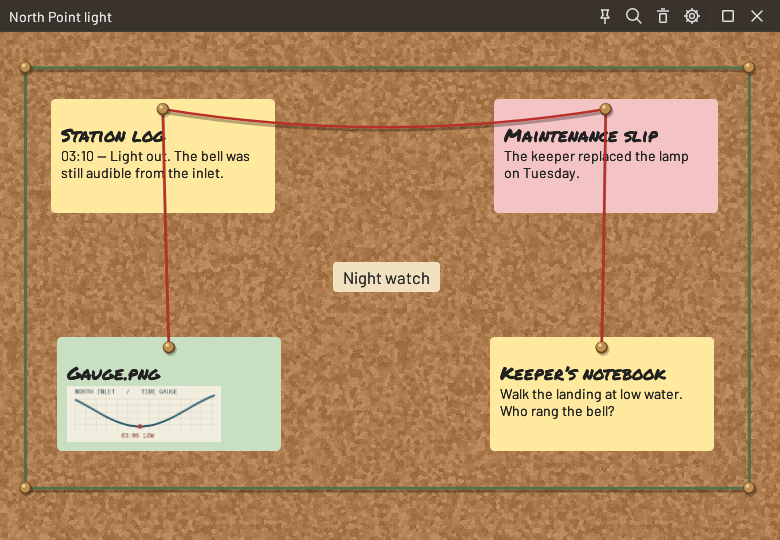
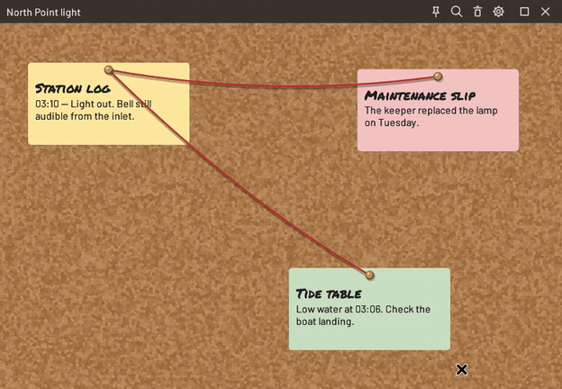
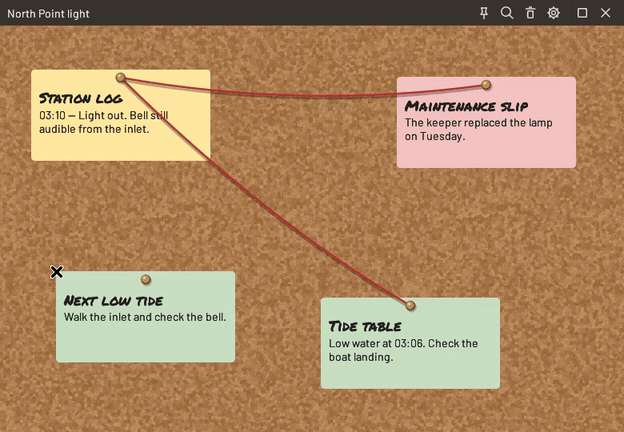
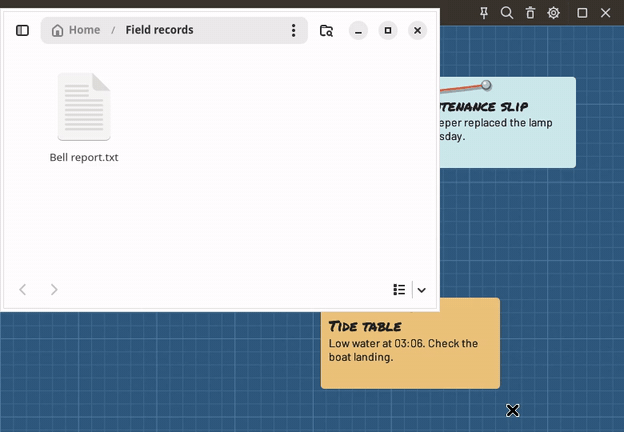
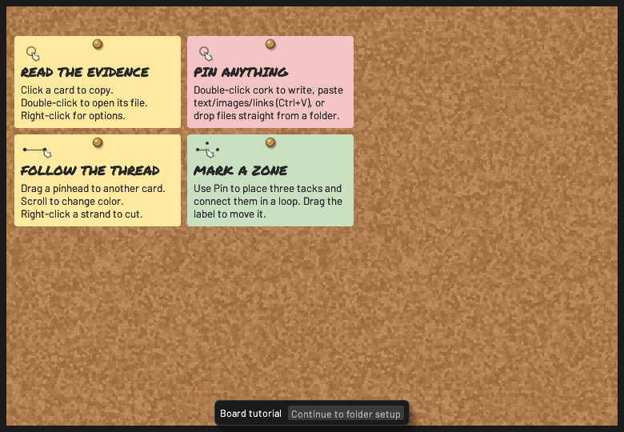
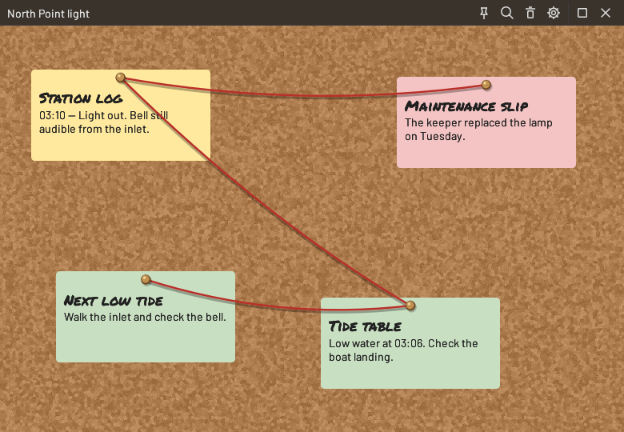

# corktop

corktop turns a folder into a desktop corkboard. Pin notes, screenshots, links, and files side by side. Pull a thread between two cards to show a connection. When you close the board, your notes are still Markdown files you can open in any editor.



## Highlights

- Choose from five material kits, from Classic Cork to Blueprint, and customize the paper, yarn, and fasteners.
- Make **Magic String Zones** by connecting tacks in a loop. Move the group by its label or arrange the cards in a grid, ring, web, or stack.
- Use the interactive desktop layer on Windows, X11, and Wayland compositors with layer-shell support.
- Export a board as a portable folder. Preview what travels and choose whether to include copies of linked files.
- True Believer Mode is off by default. Every so often, it has a 42-millisecond observation to share.

## See it in action

| Write and save a note | Connect two cards |
| --- | --- |
| [](media/write-a-note.mp4) | [](media/connect-cards.mp4) |
| **Copy and paste a card** | **Drop a file on the Blueprint board** |
| [](media/copy-and-paste.mp4) | [](media/drop-a-file.mp4) |

## Download

| Platform | 1.0.0 RC12 | To launch |
| --- | --- | --- |
| Windows x64 | [Download ZIP](https://github.com/piercehanlon/corktop/releases/download/v1.0.0-rc.12/corktop-1.0.0-windows-x64.zip) | Extract the folder and open `corktop.exe`. The executable is unsigned. Windows SmartScreen or Smart App Control may warn or block it. [Build from source](#build-from-source). |
| Linux x86-64 | [Download tar.gz](https://github.com/piercehanlon/corktop/releases/download/v1.0.0-rc.12/corktop-1.0.0-linux-x64.tar.gz) | Extract the folder and run `./corktop` inside it. This build requires glibc 2.35 or later, libxkbcommon, and an OpenGL-capable X11 or Wayland session. |

The release includes SHA-256 checksums for both downloads. If your Linux distribution has an older glibc, build from source using the instructions below. [Release notes and checksums](https://github.com/piercehanlon/corktop/releases/tag/v1.0.0-rc.12)

## Make your first board

1. Step through the quick tutorial, then choose **Browse** and select a folder. Start with an empty one, or choose **Inbox** during setup to pick which existing files to pin.
2. Double-click blank cork to write a note. Put the title on the first line and press **Ctrl+Enter** to save. You can also click blank cork and paste text, a screenshot, or a URL with **Ctrl+V**.
3. Drag a file from your file manager onto the board. Drops default to **Copy**. Choose **Ask**, **Copy**, **Link**, or **Move** in Settings.
4. Drag a card by its body to move it. Drag its pinhead onto another card to connect them. Right-click a strand to cut it.

Click a text card to copy its contents. Double-click to open its file in your editor. For more gestures, open **Settings → Help → Replay tutorial**.



## Where your work lives



The board folder holds your files. The hidden `.board.toml` file records card positions, strings, and zones. Open **Settings → Board → Export board** to create a portable folder. Review the file list, pick a destination outside the board, and enable **Include copies of linked files** to bring their contents. Without it, external links retain their original paths. Copy the entire exported folder, including hidden files, to the other computer and choose it in Browse.

## Build from source

Install Git and rustup, then clone the repository. The build reads the commit ID from Git. The checkout selects Rust 1.90.0 and includes a locked dependency list. [Install Rust](https://rust-lang.org/tools/install/)

```sh
git clone https://github.com/piercehanlon/corktop.git
cd corktop
```

**Linux.** Install a C compiler and linker, pkg-config, and the libxkbcommon and Wayland development packages. On Debian or Ubuntu, the package names are `build-essential`, `pkg-config`, `libxkbcommon-dev`, and `libwayland-dev`. Build and launch from the repository root.

```sh
cargo build --release --locked -p corktop
./target/release/corktop
```

**Windows.** Install the x64 MSVC Rust toolchain, Visual Studio’s **Desktop development with C++** workload, and a Windows SDK. Run the commands below in an x64 Developer PowerShell where `link.exe` and `rc.exe` are on PATH. [Rust’s Windows prerequisites](https://rust-lang.github.io/rustup/installation/windows-msvc.html)

```powershell
cargo build --release --locked -p corktop --target x86_64-pc-windows-msvc
.\target\x86_64-pc-windows-msvc\release\corktop.exe
```

**Cross-build Windows on Linux.** The downloadable ZIP uses the GNU target. Install the MinGW-w64 x86-64 POSIX compiler, Windows headers, and binutils (including `windres`), then run:

```sh
rustup target add x86_64-pc-windows-gnu
export CARGO_TARGET_X86_64_PC_WINDOWS_GNU_LINKER=x86_64-w64-mingw32-gcc-posix
cargo build --release --locked -p corktop --target x86_64-pc-windows-gnu
```

The executable is `target/x86_64-pc-windows-gnu/release/corktop.exe`.

### Package a release

On x86-64 Linux, install Python 3.11+, bubblewrap (with user namespaces enabled), curl, the Rust documentation component, and the MinGW tool versions in [tools.lock.toml](tools.lock.toml). From a clean checkout with the Windows GNU Rust target installed, run:

```sh
python3 scripts/release.py --packages target/downloads
```

The command builds Linux in Ubuntu 22.04, launches the extracted archive in a fresh Ubuntu 22.04 userspace, cross-builds Windows, and writes both archives with their notices and a shared `SHA256SUMS` file.

## Project scope

corktop 1.0 is feature-complete for its intended scope and shared as-is under MIT. Bug reports are welcome. Forks are the best place to explore new features and specialized platform support.

## License

corktop uses the MIT license. Bundled fonts have their own licenses. [MIT license](LICENSE) · [Font notices](THIRD_PARTY_LICENSES.md#permanent-marker) · [Third-party licenses](THIRD_PARTY_LICENSES.md)

Creator: [https://pah.moi](https://pah.moi)
